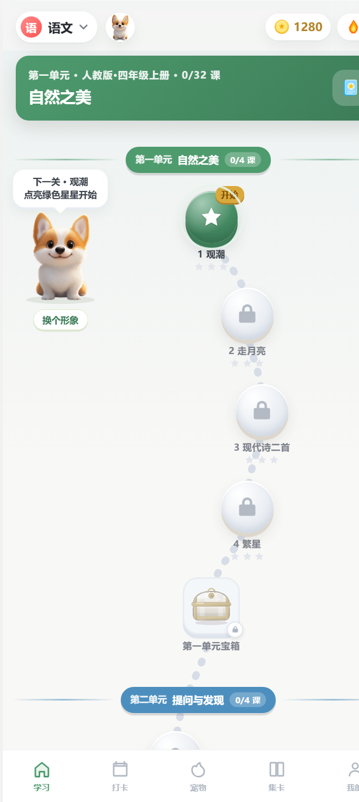
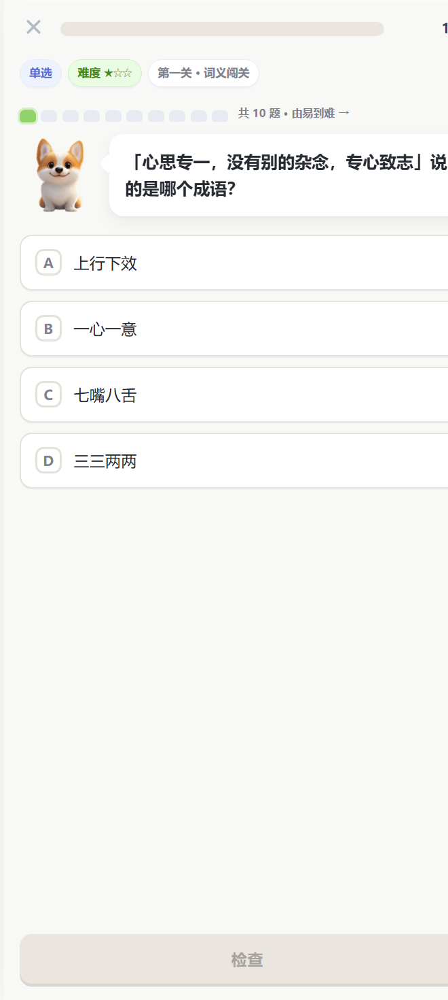
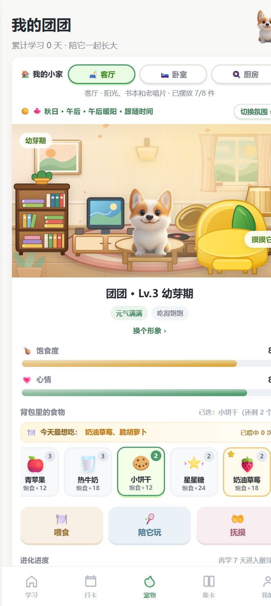
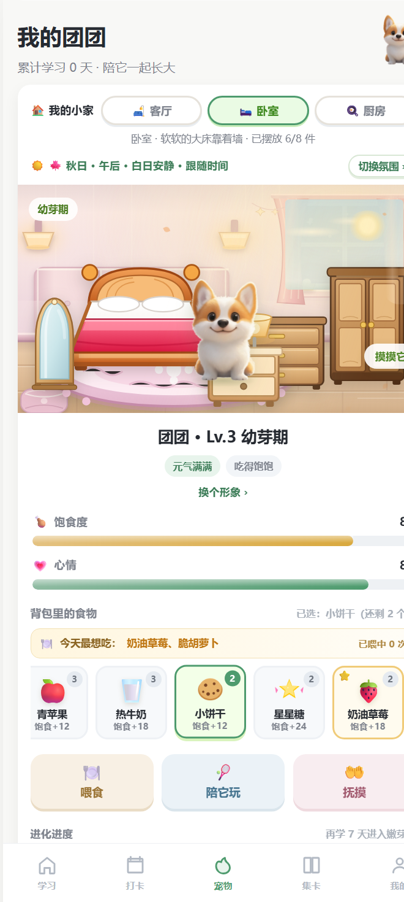
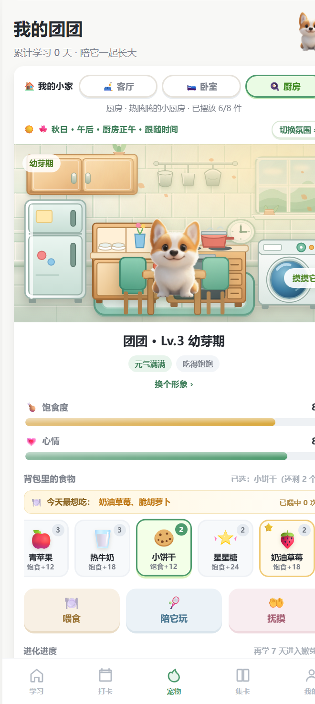
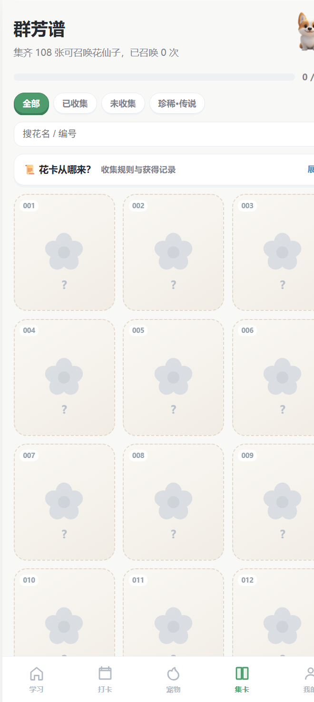

# 萌宠闯关学习岛 🐾

> 一款为「不爱学语文的 9 岁娃」量身打造的闯关养宠学习游戏——纯前端、零依赖、零构建，由宝妈与 AI 协作完成。

**在线试玩（无需安装，手机/平板/电脑均可）**：
👉 <https://cute-pet-island.app.workbuddy.host/?sharecode=ONUGCJY7SQ>

---

## 💛 为什么做这个（项目初衷）

这个项目的起点，是一位妈妈的烦恼：**9 岁的孩子对语文学习提不起兴趣**，抄写、默写、刷题每天都要拉锯半天。

与其反复催促，不如换个思路——把学习变成孩子**主动想玩**的游戏。于是借助 AI 编程工具（WorkBuddy），从零做出了这款「闯关 + 养宠 + 集卡」的学习小游戏：

> 答题闯关赚金币 → 喂养、装扮自己的萌宠 → 解锁客厅/卧室/厨房三个房间和新家具 → 收集 108 张花卡。
> 孩子为了照顾好宠物、凑齐家具，会自己主动去刷题。

如果你的孩子也遇到同样的问题，欢迎：

1. **直接在线试玩**上面的链接；
2. **下载本项目**，用 AI 添加你想教的任何课程（数学、英语、成语、古诗……都行）；
3. 部署到自己的 [WorkBuddy](https://www.workbuddy.cn) 里，生成专属链接给孩子玩。

## ✨ 功能特性

| 模块 | 说明 |
|---|---|
| 📚 课程题库 | 语文 1–6 年级上下册（人教版）共 **2235 题** + 「成语通关」**1600 题**（覆盖小学到高中常用成语），共 3835 题，全部为单选题，附解析 |
| 🗺️ 关卡地图 | 单元 → 课 → 关卡，由易到难；每单元解锁一个宝箱，还有期末终极大关 |
| 🐶 萌宠养成 | 喂食 / 陪玩 / 抚摸，饱食度、心情、等级、幼年期 → 成年期进化；6 种卡通形象可选 |
| 🏠 宠物小家 | 客厅 / 卧室 / 厨房三个可切换场景，19 件实心大件家具（书柜、大床、冰箱、洗衣机、留声机……），家具摆放在宠物背后 |
| 🃏 集卡图鉴 | 108 张花卡，答题掉落，可按收集状态/稀有度筛选 |
| 📅 每日打卡 | 连续打卡 + 幸运大转盘奖励 |
| ❌ 错题本 | 自动收录错题，答对即移出 |
| 🔊 语音鼓励 | 可爱女童声语音反馈 + 全站音效（可开关） |
| ☁️ 云存档 | 登录后跨设备同步进度；也支持 JSON 导出/导入 |

## 🖼️ 界面预览

| 闯关地图 | 答题 | 宠物·客厅 | 宠物·卧室 | 宠物·厨房 | 集卡图鉴 |
|---|---|---|---|---|---|
|  |  |  |  |  |  |

## 🚀 快速开始

本项目是**纯静态站点**：原生 HTML/CSS/JS，没有任何依赖，不需要构建。

### 方式一：直接打开

双击 `index.html` 即可在浏览器中游玩。
（个别浏览器对 `file://` 协议下的音效/图片有限制，推荐用下面的本地服务器方式。）

### 方式二：本地服务器（推荐）

```bash
# Python
python -m http.server 8000
# 或 Node
npx serve .
```

然后访问 <http://localhost:8000>。

### 方式三：部署到 WorkBuddy（生成专属分享链接）

1. 打开 WorkBuddy，进入本项目所在工作区；
2. 在对话里说：「**把这个项目发布为在线链接**」；
3. 得到一个 `https://xxx.workbuddy.host` 链接，手机/平板直接打开就能玩，进度存在浏览器里。

## 🧩 如何添加自己的课程（用 AI 3 步搞定）

题库是**纯数据文件**，非常适合让 AI（WorkBuddy、Claude、ChatGPT 等）代写。

**第 1 步：注册学科**（如果学科已存在可跳过）

在 `data/subjects.js` 的 `list` 里加一条：

```js
{ key: 'math', name: '数学', flag: '数', grades: [3], volumes: ['下册'] }
```

**第 2 步：放题库文件**

复制 `data/banks/chinese/g4-a.js` 为模板，放到 `data/banks/<学科>/<年级>.js`，核心结构：

```js
Bank.add({
  key: 'math-g3-b',                // 全局唯一
  subject: '数学', subjectKey: 'math',
  grade: 3, volume: '下册',
  book: '人教版·三年级下册',
  stages: [                        // 阶段 = 单元
    {
      id: 'u1', title: '位置与方向',
      lessons: [                   // 课
        {
          id: 'l1', title: '认识东南西北',
          qs: [
            {
              type: 'single',      // 运行时统一按单选处理
              stem: '太阳从（　）方升起。',
              options: ['东', '南', '西', '北'],
              answer: 0,           // 正确选项下标
              kp: '方位', lv: 1,   // 考核点 / 难度 1-4
              ex: '太阳每天从东方升起。'
            }
            // ……每课建议 10-15 题，由易到难（lv 递增）
          ]
        }
      ]
    }
  ]
});
```

**第 3 步：挂载脚本**

在 `index.html` 底部加一行：

```html
<script src="data/banks/math/g3-b.js"></script>
```

**给 AI 的提示词模板**（直接复制使用）：

> 请阅读 `data/banks/chinese/g4-a.js`，严格按照它的 JSON 结构和字段规范，为人教版三年级下册数学生成一套题库：8 个单元、每单元 4 课、每课 15 道题（全部单选，含正确答案与解析），知识点不重复、由易到难（难度 lv 1→4 递增），覆盖该册全部重要知识点，输出为可直接保存的 JS 文件。

## 📁 目录结构

```
xuexi/
├── index.html            # 入口页面（在此挂载题库脚本）
├── css/
│   ├── style.css         # 全站样式
│   └── room-theme.css    # 宠物房间场景样式
├── js/
│   ├── app.js            # 应用外壳 / 页面路由
│   ├── engine.js         # 学习引擎：金币、关卡、商店数据
│   ├── bank.js           # 题库注册与归一化（自动统一题型）
│   ├── quiz.js           # 答题流程
│   ├── pet.js            # 宠物页：房间/场景/商店/喂食
│   ├── store.js          # 存档（localStorage）+ 云同步 + 导入导出
│   ├── characters.js     # 卡通形象与表情
│   ├── me.js / daily.js  # 我的 / 每日打卡
│   └── ...
├── data/
│   ├── subjects.js       # 学科注册表
│   └── banks/            # 题库（按 学科/年级 分文件）
│       ├── chinese/      # 语文 1-6 年级上下册
│       └── idiom/        # 成语通关
├── images/               # 角色、家具、场景插画（SVG/PNG）
└── docs/screenshots/     # README 截图
```

## 🛠️ 技术栈

- 原生 HTML / CSS / JavaScript（ES6），**零 npm 依赖、零构建**
- 手绘 SVG 插画（家具、场景背景）+ AI 生成角色立绘
- 数据全部存浏览器 `localStorage`，支持 JSON 导出/导入与云同步

## 🤝 参与贡献

欢迎 Issue / PR！尤其是：

- 新学科、新题库（数学、英语、国学……）
- 更多卡通形象与家具插画
- 无障碍与低龄适配改进

## 📄 开源协议

本项目采用 [PolyForm Noncommercial License 1.0.0](LICENSE) 发布：

- ✅ 个人学习、家庭使用、学校与公益教育等**非商业用途**，可自由使用、修改、分发；
- ❌ 任何**商业用途**需事先与作者取得授权。

---

<p align="center">用 AI，把「不爱学习」变成「主动刷题」。💛</p>
